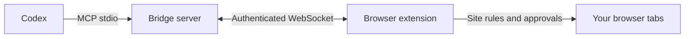

<div align="center">


# Codex Browser Bridge

**Your browser. Your tabs. Your Codex.**

An MCP server and browser extension for working in your everyday Chromium or Firefox profile.

[](RELEASE_NOTES.md)
[](#what-it-does)
[](LICENSE)
[](https://github.com/dariumi/codex-browser-bridge/actions/workflows/ci.yml)

[Quick start](#quick-start) · [Studio](docs/STUDIO.md) · [Installation](docs/INSTALL.md) · [Agent guide](docs/AGENT_SETUP.md) · **[Русский](README.ru.md)**

</div>

Connect Codex to the tabs you already use: inspect pages, fill forms, drag elements, work through multi-step tasks and verify the result. Signed-in browser sessions stay in the browser. No remote-debugging port is required for your personal profile.

> **Package availability:** npm and Python distributions are prepared in this checkout. Registry publication and ownership of the package names have not been verified. Use the built `.tgz` / `.whl` files until the first registry release; do not assume the registry commands already work.

## Quick start

Choose **one** installer. Both use the same Node.js bridge and browser extension.

| Route | Requirements | Best for |
| --- | --- | --- |
| npm | Node.js ≥22, npm | Installing the CLI directly |
| Python | Python ≥3.10, Node.js ≥22, npm | pipx / Python-managed environments |
| Git | Node.js ≥22, npm, Git; Python 3 for archive builds | Development and validated source updates |

Codex CLI must be installed and signed in to use browser chat. Loading the unpacked browser extension is a separate browser action.

### npm

Install a downloaded/built package without cloning the repository:

```sh
npm install --global ./codex-browser-bridge-0.8.1.tgz
codex-browser-bridge setup
codex-browser-bridge doctor
```

After the package is published to npm, the first line becomes:

```sh
npm install --global codex-browser-bridge
```

`setup` creates a private connection file, registers the MCP server with Codex and exports both browser add-ons to writable, stable directories. It prints the paths, never the connection key. `--no-codex` skips registration; `--no-start` prepares files without starting the daemon.

### Python

Install the wheel with pipx (recommended), or pip inside a virtual environment:

```sh
pipx install ./codex_browser_bridge-0.8.1-py3-none-any.whl
codex-browser-bridge setup
codex-browser-bridge doctor
```

After publication to PyPI: `pipx install codex-browser-bridge`.

The Python launcher includes the exact JS runtime archive and checks its SHA-256. The first `setup` installs its locked npm runtime dependencies into a versioned user cache. `bootstrap` performs only this dependency installation. Node.js and npm are required; Git is not. No install-time script changes your browser or Codex configuration automatically.

### Connect the browser

1. **Chromium / Brave / Edge:** open the browser's extensions page, enable developer mode and choose **Load unpacked** with the printed Chromium directory.
2. **Firefox:** open `about:debugging` → **This Firefox** → **Load Temporary Add-on** and select the printed Firefox `manifest.json`. Temporary add-ons must be reloaded after a browser restart; permanent distribution requires Mozilla signing.
3. Open the extension settings and import the printed `connection.json` file. Keep it private.
4. Restart/reload Codex MCP, run `codex-browser-bridge doctor`, then open a normal HTTP(S) page and its Codex chat.

[Full connection guide](docs/INSTALL.md) · [Agent setup](docs/AGENT_SETUP.md) · [Package details](docs/PACKAGES.md)

<details>
<summary><strong>Install from Git</strong></summary>

```sh
git clone https://github.com/dariumi/codex-browser-bridge.git
cd codex-browser-bridge
npm ci
npm run setup
npm run package
npm run doctor
```

Chromium loads `extension/`; Firefox loads `dist/firefox/manifest.json`. Source installations retain the existing `.local/connection.json`. See the installation guide before enabling delegated browser actions or self-development mode.

</details>

## What it does

| Capability | Included |
| --- | --- |
| Browser actions | Screenshots, snapshots, forms, keyboard, pointer and HTML dragging, scrolling and navigation |
| Chat & handoff | Page-launched chat, model/reasoning selection, progress, plans and verified task results |
| Automation Studio | Saved JSON action sequences, import/export, stop and permission-aware resume |
| View profiles | Chromium viewport/mobile/touch/theme/timezone/locale/UA; Firefox document CSS zoom and scoped UA |
| Other extensions | Exact user-configured messages to cooperating extensions with an external API |
| Media | Playback metadata, captions, animations, actual video frames and bounded audio capture where supported |
| Virtual sources | Page-scoped test microphone, camera and synthetic screen streams; optional Linux native helper |
| Site control | Ask/deny domain rules, separate advanced consent and visible permission decisions |
| Workspace | Codex tab groups, preserved original tabs and cleanup of recorded temporary tabs |
| Long tasks | Opt-in scheduled sleep/wake in managed tasks, with real progress checked after waking |
| Floating launcher | Compact, draggable, keyboard-movable and hideable; restore it from popup or Studio |
| Privacy | Session-only chat/script storage by default; explicit persistence controls and history deletion |

**38 MCP tools**, including `browser_view`, `browser_scripts`, `browser_extensions`, `browser_media`, `browser_devices`, `browser_task` and `browser_policy`.

## How it connects



The local HTTP bridge listens on loopback. Remote agents can connect to a user's browser through SSH forwarding or the optional TLS gateway. [Remote setup](docs/REMOTE.md).

## Chromium and Firefox

| Feature | Chromium | Firefox |
| --- | --- | --- |
| Main page / open Shadow DOM | Yes | Yes |
| Input | Trusted CDP events | Synthetic DOM events; some sites reject them |
| Screenshots | Viewport and full page | Viewport |
| View profiles | Native CDP emulation, per-tab zoom | Document CSS zoom; limited User-Agent override |
| Raw CDP, native upload/dialog, console/network capture | Available | Unavailable |
| Cross-frame input | Advanced CDP route | Higher-level frame targeting unavailable |

User-Agent changes do not replace the entire device fingerprint. Autoplay, CORS, DRM, browser-internal pages and protected extension stores can limit actions. Report unsupported operations honestly. [Studio boundaries](docs/STUDIO.md) · [Diagnostics / Complex Lab](docs/DIAGNOSTICS.md).

## Configuration and upgrades

Package installs keep connection keys, task state and exported extensions **outside `node_modules` / site-packages**. On Linux the default state directory is `~/.local/state/codex-browser-bridge`; macOS and Windows use their user application-data directories. Override with `BROWSER_BRIDGE_HOME` or the exact `BROWSER_BRIDGE_CONFIG` path. A Git checkout continues using `.local/` unless overridden.

```sh
codex-browser-bridge extension                    # Export or update both add-ons
codex-browser-bridge extension --browser firefox  # Export Firefox only
codex-browser-bridge doctor --json               # Diagnose without printing secrets
```

Exports detect local edits and refuse to overwrite them. `--force` explicitly replaces an existing bridge export. Keep export paths stable so the browser can retain its extension settings.

- **npm/Python installations:** upgrade with the package manager, rerun `setup`, run `codex-browser-bridge restart`, restart MCP and reload the exported add-on. Git-based self-updates and source editing are disabled in package installations.
- **Git installations:** official-source update checks, scoped user policy, detached-worktree validation and rollback remain available. Dirty checkouts are preserved. Self-development requires a source checkout.

[Complete package and publishing guide](docs/PACKAGES.md)

## Security and responsibility

The agent can act through signed-in accounts. Review the tasks you delegate. Built-in sensitive-site rules are a starting point: add your own protected domains. Only the user can approve access; scripts and integrations do not grant permission or weaken site restrictions.

Never share `connection.json`, tokens, private task history or your stored script library. Package allowlists exclude local configuration, logs and browser artifacts. Messages from pages and other extensions remain untrusted.

Provided under the [MIT License](LICENSE), without warranties. To the extent permitted by law, authors and contributors accept no liability for agent actions or consequences. Read the [Disclaimer](DISCLAIMER.md).

## Build and contribute

```sh
npm ci
npm run check
npm test
npm run package
npm run lint:firefox
npm run test:isolated
npm run test:firefox
npm run pack:npm
npm run pack:python
npm run test:python
```

Python wheel builds require Python, setuptools ≥77 and wheel (or use `python -m build`, which creates an isolated build environment). Package builds do not publish anything. Current verification scope and environment limitations are recorded in [TESTING.md](TESTING.md).

[Installation](docs/INSTALL.md) · [Studio](docs/STUDIO.md) · [Devices](docs/DEVICES.md) · [Remote](docs/REMOTE.md) · [Diagnostics](docs/DIAGNOSTICS.md) · [Release notes](RELEASE_NOTES.md)
