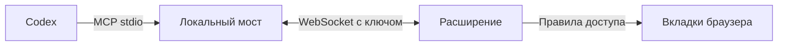

<div align="center">


# Codex Browser Bridge

**Твой браузер. Твои вкладки. Твой Codex.**

MCP-сервер и расширение для работы в обычном профиле Chromium или Firefox.

[](RELEASE_NOTES.md)
[](#возможности)
[](LICENSE)
[](https://github.com/dariumi/codex-browser-bridge/actions/workflows/ci.yml)

[Установка](#быстрый-старт) · [Студия](docs/STUDIO.md) · [Инструкция](docs/INSTALL.ru.md) · [Для агента](docs/AGENT_SETUP.md) · **[English](README.md)**

</div>

Codex видит страницы, заполняет формы, перемещает элементы и проходит задачи по этапам в уже открытом браузере. Авторизованные сессии остаются в браузере. Порт удалённой отладки личного профиля не требуется.

> **Статус пакетов:** npm- и Python-дистрибутивы подготовлены в исходниках. Публикация в реестрах и владение именами пока не подтверждены. До первого выпуска устанавливайте собранные `.tgz` / `.whl`; команды установки по имени начнут работать после публикации.

## Быстрый старт

Выберите **один** способ установки — оба пакета используют общий Node.js-движок и расширение.

| Способ | Требуется | Назначение |
| --- | --- | --- |
| npm | Node.js ≥22, npm | Прямая установка CLI |
| Python | Python ≥3.10, Node.js ≥22, npm | Установка через pipx или виртуальное окружение |
| Git | Node.js ≥22, npm, Git; Python 3 для ZIP-сборок | Разработка и проверяемое обновление исходников |

Для чата нужен установленный Codex CLI с выполненным входом. Расширение устанавливается в браузер отдельным действием.

### npm

Установка из скачанного или собранного архива без клонирования репозитория:

```sh
npm install --global ./codex-browser-bridge-0.8.1.tgz
codex-browser-bridge setup
codex-browser-bridge doctor
```

После публикации в npm первая команда будет такой:

```sh
npm install --global codex-browser-bridge
```

`setup` создаёт приватный файл подключения, регистрирует MCP в Codex и экспортирует оба расширения в постоянные доступные для записи папки. Команда выводит пути, а не ключ. `--no-codex` пропускает регистрацию, `--no-start` — запуск фонового моста.

### Python

Рекомендуется pipx; также подойдёт pip внутри виртуального окружения:

```sh
pipx install ./codex_browser_bridge-0.8.1-py3-none-any.whl
codex-browser-bridge setup
codex-browser-bridge doctor
```

После публикации в PyPI: `pipx install codex-browser-bridge`.

Python-лаунчер содержит точный JS-архив и проверяет его SHA-256. Первый `setup` устанавливает закреплённые npm-зависимости движка в версионный пользовательский кэш. `bootstrap` выполняет только установку зависимостей. Node.js и npm обязательны; Git не нужен. Обычная установка пакета не меняет настройки браузера или Codex автоматически.

### Подключение браузера

1. **Chromium / Brave / Edge:** откройте страницу расширений, включите режим разработчика, выберите **Загрузить распакованное расширение** и укажите выведенную папку Chromium.
2. **Firefox:** `about:debugging` → **Этот Firefox** → **Загрузить временное дополнение** → выведенный `manifest.json`. Временное дополнение загружается заново после перезапуска браузера; постоянная установка требует подписи Mozilla.
3. В настройках расширения импортируйте выведенный `connection.json`. Не публикуйте этот файл.
4. Перезапустите MCP в Codex, выполните `codex-browser-bridge doctor`, откройте HTTP(S)-страницу и её чат Codex.

[Подробная инструкция](docs/INSTALL.ru.md) · [Установка для агента](docs/AGENT_SETUP.md) · [Пакеты и публикация](docs/PACKAGES.md)

<details>
<summary><strong>Установка через Git</strong></summary>

```sh
git clone https://github.com/dariumi/codex-browser-bridge.git
cd codex-browser-bridge
npm ci
npm run setup
npm run package
npm run doctor
```

Chromium загружает `extension/`, Firefox — `dist/firefox/manifest.json`. Существующий `.local/connection.json` сохраняется. Перед включением делегирования и доработки исходников прочитайте инструкцию.

</details>

## Возможности

| Функция | Что доступно |
| --- | --- |
| Управление страницей | Скриншоты, snapshot, формы, клавиатура, перетаскивание, прокрутка и навигация |
| Чат и передача задачи | Чат из страницы, модель и рассуждение, план, прогресс и проверка результата |
| Студия автоматизации | JSON-сценарии, импорт/экспорт, остановка и продолжение после разрешения |
| Представление | Viewport/mobile/touch, тема, timezone/locale и UA в Chromium; CSS-масштаб и ограниченный UA в Firefox |
| Другие расширения | Точные шаблоны сообщений пользователя для расширений с внешним API |
| Медиа | Состояние видео/аудио, субтитры, анимации, реальные кадры и ограниченная запись звука |
| Виртуальные источники | Тестовые микрофон, камера и экран текущей страницы; дополнительный Linux native host |
| Доступ к сайтам | Правила «спросить/запретить», отдельное разрешение JavaScript/CDP |
| Вкладки | Рабочие группы, сохранение исходных вкладок, уборка только записанных временных вкладок |
| Длительная работа | Явно включаемый сон и пробуждение управляемой задачи с проверкой прогресса |
| Плавающая кнопка | Компактный вид, перемещение мышью/клавиатурой, скрытие и восстановление |
| Приватность | Хранение чата и сценариев в сессии по умолчанию, отдельное включение записи на диск |

**38 MCP-инструментов**, включая `browser_view`, `browser_scripts`, `browser_extensions`, `browser_media`, `browser_devices`, `browser_task` и `browser_policy`.

## Схема работы



HTTP-мост слушает loopback. Для удалённого агента доступны SSH-проброс или дополнительный TLS-шлюз. [Удалённое подключение](docs/REMOTE.md).

## Chromium и Firefox

| Функция | Chromium | Firefox |
| --- | --- | --- |
| Страница и открытый Shadow DOM | Да | Да |
| События ввода | Доверенные CDP-события | Синтетические DOM-события; некоторые сайты их отклоняют |
| Скриншоты | Область просмотра и вся страница | Область просмотра |
| Представление | CDP-эмуляция, масштаб отдельной вкладки | CSS-масштаб документа, ограниченная подмена UA |
| Raw CDP, загрузка файлов, диалоги, console/network | Доступны | Недоступны |
| Ввод во фреймы | Дополнительный CDP-сценарий | Высокоуровневый выбор фрейма отсутствует |

Подмена User-Agent не меняет весь отпечаток устройства. Autoplay, CORS, DRM и защищённые страницы могут ограничивать действия. Неподдерживаемые этапы следует обозначать явно. [Границы студии](docs/STUDIO.md) · [Диагностика и Complex Lab](docs/DIAGNOSTICS.md).

## Настройки и обновления

Пакетная установка хранит ключи, состояние задач и экспортированные расширения **вне `node_modules` / site-packages**. В Linux по умолчанию используется `~/.local/state/codex-browser-bridge`, в macOS и Windows — пользовательская папка данных приложения. Путь можно задать через `BROWSER_BRIDGE_HOME` или `BROWSER_BRIDGE_CONFIG`. Git-установка сохраняет `.local/`.

```sh
codex-browser-bridge extension
codex-browser-bridge extension --browser firefox
codex-browser-bridge doctor --json
```

Экспорт обнаруживает локальные правки и отказывается их перезаписывать. `--force` явно заменяет существующий экспорт Bridge. Постоянный путь помогает браузеру сохранить настройки расширения.

- **npm/Python:** обновите пакет менеджером, повторите `setup`, выполните `codex-browser-bridge restart`, перезапустите MCP и перезагрузите дополнение. Git-самообновление и редактирование установленного пакета отключены.
- **Git:** доступны проверки официального источника, политика обновлений, валидация в отдельном worktree и откат. Незакоммиченные изменения сохраняются. Для доработки исходников используйте отдельный Git checkout.

[Полное руководство по пакетам](docs/PACKAGES.md)

## Доступ и ответственность

Агент выполняет действия через авторизованные аккаунты. Проверяйте передаваемые задачи. Стандартный список чувствительных сайтов — отправная точка: добавляйте свои домены. Разрешение выдаёт пользователь; сценарии и интеграции его не предоставляют.

Не передавайте `connection.json`, токены, приватную историю или личную библиотеку сценариев. В дистрибутивы не включаются локальные настройки, логи и браузерные артефакты. Данные страниц и ответы других расширений остаются недоверенными.

Проект поставляется по [MIT License](LICENSE) без гарантий. В пределах, допускаемых законом, авторы и участники не несут ответственности за действия агента и последствия. [Уведомление об ответственности](DISCLAIMER.md).

## Разработка

```sh
npm ci
npm run check
npm test
npm run package
npm run lint:firefox
npm run test:isolated
npm run test:firefox
npm run pack:npm
npm run pack:python
npm run test:python
```

Для wheel-сборки нужны Python, setuptools ≥77 и wheel; `python -m build` может подготовить изолированное окружение сборки. Сборка не публикует пакеты. Фактические проверки и ограничения окружения записаны в [TESTING.md](TESTING.md).

[Установка](docs/INSTALL.ru.md) · [Студия](docs/STUDIO.md) · [Устройства](docs/DEVICES.md) · [Удалённая работа](docs/REMOTE.md) · [Диагностика](docs/DIAGNOSTICS.md)
